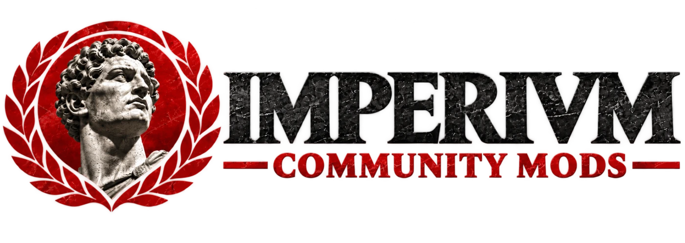

  <picture>
    <source media="(prefers-color-scheme: dark)" srcset="assets/banner-dark.webp">
    
  </picture>

<b>English</b> · <a href="README.es.md">Español</a>

  
  
  
  
  
  

# Community Mods

Port the community's mods, maps and adventures to [Imperivm Resurrected](https://github.com/imperivm-resurrected/imperivm-resurrected)
and publish them on [GameBanana](https://gamebanana.com/games/26069), crediting each author.

## Where to start

| I want to… | Go to |
|---|---|
| See what can be ported, and what is already done | [`docs/MODS.md`](docs/MODS.md) |
| See what is left to port | [`docs/PENDING.md`](docs/PENDING.md) |
| Port a mod | [`docs/SETUP.md`](docs/SETUP.md), then [`docs/PORTING.md`](docs/PORTING.md) |
| Find the right script | [`docs/TOOLS.md`](docs/TOOLS.md) |
| Contribute as a person or as an agent | [`AGENTS.md`](AGENTS.md) (commit style, tables, credits) |
| Find more mods | [`docs/SOURCES.md`](docs/SOURCES.md) |
| Get the original games | [`docs/GAMES.md`](docs/GAMES.md) |

The full index is in [`docs/README.md`](docs/README.md).

## Repository layout

| Path | What it is |
|---|---|
| [`docs/`](docs/README.md) | All the documentation: guides and tables. Spanish copies of the guides are in [`docs/es/`](docs/es/README.md) |
| [`ported/`](ported/) | Each ported mod, with its `mod.json`. Third-party binaries (`.bfhp`, `.bmp`, `.pak`, `.avi`) and the folders rebuilt by `port-140.js` aren't in git |
| [`extras/`](extras/) | Our own changes to a mod: hand-resolved files, fixes, preview images, `mod.json` with credits. The tools copy them into `ported/<id>/` |
| [`raw/`](raw/) | Mod entries pulled from Discord, the forum and ModDB (`*-entries.json`, `moddb.json`), link checks (`links.json`), downloads (`download-log.json`), which row each ported mod comes from (`ported.json`), Imperivm I equivalents, `port-140` reports |
| [`tools/`](tools/) | The scripts, see [`docs/TOOLS.md`](docs/TOOLS.md) |
| [`assets/`](assets/) | Banners for this README |

Downloads and extracted game data go in `originals/`, outside git (see [`docs/SETUP.md`](docs/SETUP.md)).

## Authors and removal requests

Every mod is published with full credit to its original author. Many of these modders and editors are no longer active, so reaching them is often hard. In any case, if a modder or editor asks for their mod to be removed, it will be removed from GameBanana and from this repository, no questions asked.

## Sources and license

The data was gathered from the *Imperivm III Editores* Discord server, the [imperivmgbr.foroactivo.com](https://imperivmgbr.foroactivo.com) forum, [ModDB](https://www.moddb.com) and [GameBanana](https://gamebanana.com/games/26069). More places to look are in [`docs/SOURCES.md`](docs/SOURCES.md).

The scripts in `tools/` are GPL-3.0 (see [LICENSE](LICENSE)), like Imperivm Resurrected. The maps, adventures and mods, and their names and descriptions, belong to their authors and are not covered by it.
